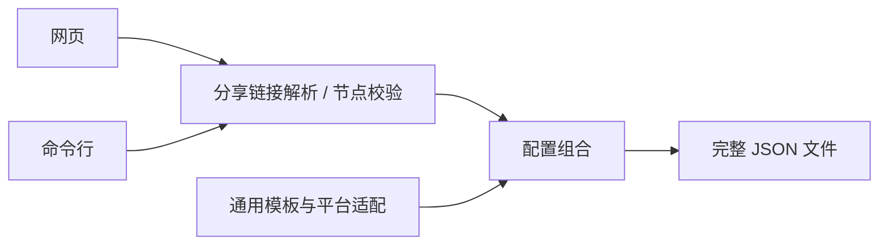

# 模块结构与修改入口

网页和命令行都走同一条流程：节点输入 → 标准出站对象 → 组合平台模板 → JSON。
核心模块使用原生 ES Modules，无第三方运行依赖，不访问网络、Git 或浏览器存储。



| 模块 | 位置 | 负责什么 |
| --- | --- | --- |
| 公共 API | `docs/assets/config-core.mjs` | 网页、CLI 和其他项目共用的入口 |
| 分享链接 | `docs/assets/core/protocols/` | 各协议的解码、TLS 与传输设置 |
| 协议注册 | `docs/assets/core/share-links.mjs` | 把 URI scheme 分派给协议适配器 |
| 节点数据 | `docs/assets/core/nodes.mjs` | 节点校验、名称处理、UDP 能力选择 |
| 配置组合 | `docs/assets/core/render.mjs` | 注入节点、更新策略组、检查引用；不修改传入对象 |
| 平台目录 | `docs/assets/core/catalog.mjs` | 支持的平台、内核版本与默认场景 |
| 默认策略 | `templates/`、`scripts/policy-layout.jq` | DNS、分流规则、公共策略组 |
| 平台适配 | `scripts/sync-platforms.sh` | 生成不同系统和内核版本的配置 |
| 网页交互 | `docs/assets/app.mjs`、`app.css` | 输入、预览、下载与布局 |
| 页面与翻译 | `web/page.html`、`web/locales/` | 一份页面结构，两份独立翻译 |
| 命令行 | `scripts/generate.mjs` | 本地文件与 stdin 输入、原子写入、0600 文件权限 |

`docs/index.html`、`docs/en/index.html` 和 `docs/assets/profiles.mjs` 是生成产物。
修改源文件后运行对应脚本；CI 会检查它们是否同步。

## 复用生成逻辑

```js
import {parseNodes, renderConfig} from './docs/assets/config-core.mjs';

const nodes = parseNodes(text); // 分享链接、节点 JSON 文档、出站数组或单个出站
const config = renderConfig(template, nodes);
const json = JSON.stringify(config, null, 2);
```

`parseNodes()` 输出 `{outbounds, udp_outbounds}`。`renderConfig()` 接受这份数据和
普通 sing-box 模板对象，返回完整配置。它不会读取文件，也不会上传或保存数据；
调用者决定输入来源与输出位置。错误以 `ConfigError.code` 和可选的位置返回，
`errorMessage()` 提供不含输入内容的提示。

## 修改默认规则

1. 修改 `templates/` 中的对应源模板；公共策略组结构由 `policy-layout.jq` 规范化。
2. 运行 `./scripts/sync-platforms.sh`，同时更新平台配置与浏览器模板包。
3. 用 1.13 和 1.14 两个内核运行检查，确认版本兼容性与 UDP 路由顺序。

个人规则也可以写进独立的私有模板，再用
`node scripts/generate.mjs --template /path/to/private/template.json ...` 生成。

## 增加节点协议

1. 在 `core/protocols/` 新增一个适配器，返回 sing-box 出站对象。
2. 在 `core/share-links.mjs` 注册 URI scheme。
3. 在 `core/nodes.mjs` 声明节点类型、必要字段及 UDP 能力。
4. 为合法链接、无效参数、编码和凭据保护增加测试；用两个真实内核验证输出。

不支持的链接参数应明确报错，避免默默丢弃 TLS、证书或传输设置。

## 修改页面或翻译

```bash
python3 -B scripts/build-pages.py
./scripts/check-pages.sh
node scripts/check-browser.mjs
```

页面保持纯前端，通过 GitHub Pages 发布。CSP 的 `connect-src 'none'` 阻止页面
脚本发送运行时请求；模板包随网页一起提供。节点不放入 URL、浏览器持久存储或日志。

## 私人仓如何复用

保持两个 Git 仓库独立，只调用公开工具并把输入输出路径指向私人仓：

```bash
node /path/to/public/scripts/generate.mjs --platform android --core 1.14 \
  --input /path/to/private/nodes.json \
  --output /path/to/private/generated/sing-box.json
```

工具不执行 Git 操作，不复制节点到公开仓。可在私人项目中固定公共工具的版本，
验证后再升级。此处提供复用接口，现有私人仓的配置、部署与提交流程由其自身管理。
