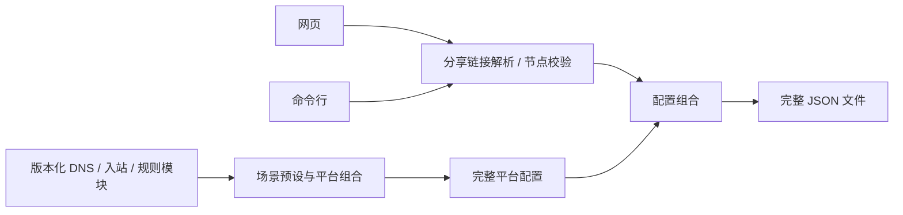

# 模块结构与修改入口

网页和命令行都走同一条流程：节点输入 → 标准出站对象 → 组合平台模板 → JSON。
核心模块使用原生 ES Modules，无第三方运行依赖，不访问网络、Git 或浏览器存储。



| 模块 | 位置 | 负责什么 |
| --- | --- | --- |
| 公共 API | `docs/assets/config-core.mjs` | 网页、CLI 和其他项目共用的入口 |
| 分享链接 | `docs/assets/core/protocols/` | 各协议的解码、TLS 与传输设置 |
| 协议注册 | `docs/assets/core/share-links.mjs` | 把 URI scheme 分派给协议适配器 |
| 节点数据 | `docs/assets/core/nodes.mjs` | 节点校验、名称处理、UDP 能力选择 |
| 配置组合 | `docs/assets/core/render.mjs` | 注入节点、更新策略组、检查引用；不修改传入对象 |
| 平台目录 | `docs/assets/core/catalog.mjs` | 支持的平台、内核版本与默认场景 |
| 配置模块 | `modules/<类别>/<版本>/<方案>.json` | 独立维护 DNS、入站、路由、规则集；共享策略组与缓存模块 |
| 构建目录与场景组合 | `modules/catalog.json` | 声明版本、平台适配与全部场景选用的模块 |
| 构建入口 | `scripts/build.py` | 一次生成平台 JSON、浏览器包与中英文页面；`--check` 只检查同步 |
| 验证入口 | `scripts/check.py` | 默认执行静态、所选内核和浏览器检查；规则集下载单独触发 |
| 开发工具内部模块 | `scripts/lib/` | 配置组合、页面、公共审计、平台契约和规则集检查；仅 Python 标准库 |
| 回归测试 | `tests/` | Python 与 Node 单元测试、真实内核集成测试、Chrome 端到端测试 |
| 测试数据 | `tests/fixtures/` | 内核测试共用的公开占位节点；用户格式示例见 [nodes.md](nodes.md) |
| 网页交互 | `docs/assets/app.mjs`、`app.css` | 输入、预览、下载与布局 |
| 页面与翻译 | `web/page.html`、`web/locales/` | 一份页面结构，两份独立翻译 |
| 命令行 | `scripts/generate.mjs` | 本地文件与 stdin 输入、原子写入、0600 文件权限 |

`platforms/` 中的 JSON、`docs/assets/presets.mjs`、
`docs/index.html`、`docs/en/index.html` 和 `docs/assets/profiles.mjs` 是生成产物。
修改源文件后统一运行 `python3 -B scripts/build.py`；CI 会检查它们是否同步。

## 复用生成逻辑

```js
import {parseNodes, renderConfig} from './docs/assets/config-core.mjs';

const nodes = parseNodes(text); // 分享链接、节点 JSON 文档、出站数组或单个出站
const config = renderConfig(template, nodes);
const json = JSON.stringify(config, null, 2);
```

`parseNodes()` 输出 `{outbounds, udp_outbounds}`。`renderConfig()` 接受这份数据和
普通 sing-box 模板对象，返回完整配置。它不会读取文件，也不会上传或保存数据；
调用者决定输入来源与输出位置。错误以 `ConfigError.code` 和可选的位置返回，
`errorMessage()` 提供不含输入内容的提示。

## 修改默认规则

1. 在 `modules/dns/1.14/fakeip.json` 等对应的类别、版本和方案中修改配置。
2. 如需组合新场景，在 `modules/catalog.json` 的 `scenarios` 中选择 DNS、入站、规则等模块，再在 `platforms` 中登记支持的平台；网页场景名称与说明位于 `docs/assets/app.mjs`。
3. 运行 `python3 -B scripts/build.py`，更新全部构建产物。
4. 运行 `python3 -B scripts/check.py static`，再用 `check.py core --sing-box /path/to/checker` 验证目标内核。

详细目录与修改例子见[配置模块](../modules/README.md)。对象递归合并、数组保持原顺序，
同一字段由两个模块重复定义时构建失败；各版本独立选择模块，不会自动回退到其他版本。
三个版本均放在 `platforms/<平台>/<版本>/`，各 17 份，共 51 份配置。
1.13 / 1.14 为稳定兼容线；1.15 标记为**实验版**，
按[实验说明](experimental-1.15.md)使用固定 alpha 检查器验证。

个人规则可以从相应平台配置复制到独立的私有模板中修改，再用
`node scripts/generate.mjs --template /path/to/private/template.json ...` 生成。

## 增加节点协议

1. 在 `docs/assets/core/protocols/` 新增适配器，返回 sing-box 出站对象。
2. 在 `docs/assets/core/share-links.mjs` 注册 URI scheme。
3. 在 `docs/assets/core/nodes.mjs` 声明节点类型、必要字段及 UDP 能力。
4. 增加解析和凭据保护测试，再用三套维护内核的 `check.py core` 检查输出。

不支持的链接参数应明确报错，避免默默丢弃 TLS、证书或传输设置。

## 修改页面或翻译

```bash
python3 -B scripts/build.py
python3 -B scripts/check.py static
python3 -B scripts/check.py browser
```

页面保持纯前端，通过 GitHub Pages 发布。CSP 的 `connect-src 'none'` 阻止页面
脚本发送运行时请求；模板包随网页一起提供。节点不放入 URL、浏览器持久存储或日志。

## 外部项目复用

调用 CLI 时，将输入和输出指向自己的项目：

```bash
node /path/to/public/scripts/generate.mjs --platform android --core 1.14 \
  --input /path/to/private/nodes.json \
  --output /path/to/private/generated/sing-box.json
```

建议固定本工具版本，验证后再升级。CLI 不执行 Git 操作或部署。
